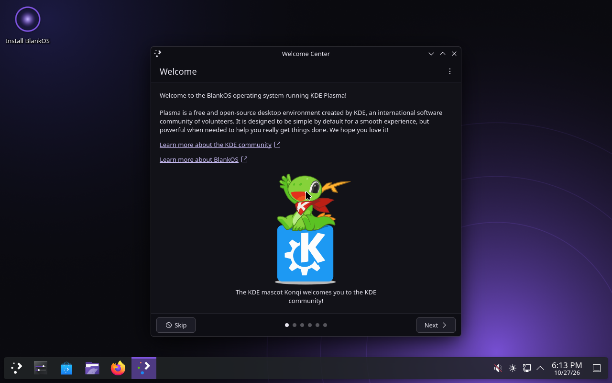

# BlankOS

A gaming-focused Linux distribution built **from scratch** ([LFS 13.1, systemd edition](https://www.linuxfromscratch.org/lfs/)),
managed with **pacman**, with a **KDE Plasma 6** desktop in a dark + electric-violet (`#8B5CF6`) look.

Everything is built from this repository by GitHub Actions: the LFS toolchain, every package, the disk/ISO images, and
a QEMU boot test.

> **Status:** Milestones 1–5 are done: the base system, a live ISO for UEFI and old BIOS PCs, the system stack
> (Mesa/Vulkan, PipeWire, Bluetooth, NetworkManager, firmware, Flatpak), the **KDE Plasma 6 desktop** (Wayland, SDDM,
> KDE apps, Firefox) and the **gaming layer** (Wine, DXVK, VKD3D-Proton, GameMode, MangoHud, controllers and the
> BlankOS Game Hub for Steam and Roblox). CI boot-tests every ISO as a UEFI CD, a BIOS USB stick and on an emulated
> Core 2 Duo. Milestones 6 and 7 add the BlankOS look, the Calamares installer and NVIDIA support. See [the roadmap](#roadmap).



## Try it

Download the latest ISO (and its `.sha256`) from the
[**live** release](https://github.com/number1victoryroyale/BlankOS/releases/tag/live). Then either:

- **USB stick, Windows:** write it with [Rufus](https://rufus.ie) (choose **DD image** mode when asked) or
  [balenaEtcher](https://etcher.balena.io).
- **USB stick, Linux:** `sudo dd if=blankos-*.iso of=/dev/sdX bs=4M status=progress oflag=sync`.
- **VM:** use the ISO directly in VirtualBox, virt-manager or QEMU.

The ISO boots on UEFI and on old BIOS-only PCs, and runs on any 64-bit CPU (Core 2 / Athlon 64 and newer). Turn
Secure Boot off first. It starts straight into Plasma as the `live` user (no password).

- **NVIDIA (GTX 16 / RTX and newer, e.g. the Razer Blade's Quadro RTX 5000):** pick **BlankOS live (NVIDIA)** in
  the boot menu. Laptops keep the desktop on the integrated GPU; run games on the NVIDIA one with
  `prime-run %command%` in Steam or "Run on dedicated graphics card" in the app menu. The installer keeps the
  choice; `blankos-nvidia-setup nvidia|open` switches later.
- **Install:** double-click **Install BlankOS** on the desktop (Calamares: erase a disk or pick partitions).

- **Games:** the **BlankOS Game Hub** opens on the first login. One click installs Steam, Sober (Roblox), Heroic,
  Lutris or ProtonUp-Qt from Flathub. Windows programs run with `wine program.exe`; `blankos-wine-dx install` adds
  DXVK and VKD3D-Proton to a Wine prefix. In Steam, launch options like `gamemoderun mangohud %command%` turn on the
  performance mode and the FPS overlay; `gamescope -W 2560 -H 1440 -r 144 -- %command%` runs a game in Valve's
  compositor (upscaling, frame limits).
- **Wi-Fi and Bluetooth:** the tray icons (Plasma's network and Bluetooth applets).
- **Apps:** Discover (Flathub), Firefox, Dolphin, Konsole, Kate, Spectacle, Ark, Gwenview.
- **Controllers:** Xbox (USB and Bluetooth with xpadneo), PlayStation, Switch, Steam and 8BitDo controllers work out of
  the box.

## How it's built

```
toolchain/   LFS ch. 5-7 (cross toolchain + temporary tools) and a pacman/makepkg bootstrap
             -> builder-rootfs.tar.zst: the chroot every package is built in
pkgs/core/   one PKGBUILD per package: LFS ch. 8 (+ kernel, pacman, GnuPG, BlankOS bits)
             ORDER = build order (same order as the book)
pkgs/extra/  graphics, sound, Bluetooth, networking, firmware, Flatpak (BLFS-based; DEPENDS: core)
pkgs/desktop/ Qt 6, KDE Frameworks, Plasma, SDDM, KDE apps, Firefox (DEPENDS: extra)
pkgs/gaming/ MinGW-w64, Wine, DXVK, VKD3D-Proton, GameMode, MangoHud, gamescope, controllers, Game Hub (DEPENDS: desktop)
tools/       build-repo.sh (build a repo inside the builder), pkgsrc.sh (fetch sources,
             pin checksums), ci-release.sh (GitHub Releases as pacman repos)
image/       mkimage.sh: UEFI disk image from the [core] repo
iso/         mkiso.sh: hybrid live ISO (BIOS + UEFI, CD or USB stick)
tests/       boot-test.py + selftest.sh: boot the image in QEMU and check it
config/      makepkg.conf, build settings
```

1. **Toolchain stage.** The book's chapters 5–7 run unmodified (as the `lfs` user, then in a chroot). Pacman and makepkg
   are then bootstrapped inside that temporary system.
2. **Package stage.** From chapter 8 on, every package is a `PKGBUILD` built by `makepkg` as an unprivileged user and
   installed with `pacman -U`, one after another in book order. Each one overwrites the temporary tool it replaces, just
   as the book's `make install` does. The result is a pacman repository in which every file on the final system is
   owned by a package.
3. **Image stage.** A fresh root is created with `pacman --root … -S base linux grub`, then packed into a GPT disk
   (ESP + ext4) without using loop devices.
4. **Test stage.** QEMU boots the image with OVMF, logs in on the serial console and runs `tests/selftest.sh`. That
   checks systemd state, the pacman database, networking, locales, gaming sysctls, the C/C++ toolchain, Python modules
   and more.

### Build it yourself (Ubuntu/Debian host, root required)

```sh
sudo toolchain/host-prep.sh          # host packages, /bin/sh -> bash
sudo toolchain/build-toolchain.sh    # ~2-3 h on 4 cores; resumable
sudo tools/build-repo.sh core        # ~4-7 h; resumable, skips already-built packages
sudo image/mkimage.sh --test --pkgs "base base-devel linux grub"
sudo tests/boot-test.py out/image/blankos.img
```

Paths can be changed with `LFS=`, `SRC=` and `OUT=` (see `config/blankos.conf`).

### Cloud build

`.github/workflows/build.yml` runs `lint → toolchain → core (3 passes) → extra (3) → desktop (5) → gaming (3) → disk
image + ISO, each boot-tested`.
The ISO is tested three ways (UEFI CD, BIOS USB stick, emulated Core 2 Duo; the UEFI run also saves a screenshot of
the desktop) and then published to the `live` release.

- **Packages:** published as release assets, one release per repo (tag `core`, …). Pacman uses them directly:
  `Server = https://github.com/<owner>/BlankOS/releases/download/$repo`.
- **Builder:** the builder rootfs is cached in the `builder` release, keyed by a hash of the toolchain inputs. It's only
  rebuilt when the toolchain changes.
- **Resuming:** each pass gets about 5.5 h. A pass that runs out of time publishes what it finished, and the next pass
  continues from there. After the first full build, a run only rebuilds packages whose `pkgver`/`pkgrel` changed.

> The first full build uses roughly 25 runner-hours (Qt, KDE and Wine are most of it). GitHub gives **public** repositories unlimited Actions minutes;
> private repositories only get the monthly quota of their plan.

## Decisions

| Area | Choice |
|---|---|
| Base | LFS 13.1 systemd book, merged `/usr` layout, plain x86-64 baseline (runs on any 64-bit PC, old laptops included) |
| Packages | pacman 7.1 + makepkg, with Arch-style PKGBUILDs and package names |
| Kernel | Latest stable (7.3), built from Arch's config plus `pkgs/core/linux/config.blankos`: full preemption, 1000 Hz, NTSYNC for Wine |
| Desktop | KDE Plasma 6 (Wayland), SDDM, Calamares installer |
| Theme | Near-black base, electric violet `#8B5CF6` accent: GRUB, Plymouth, SDDM, Plasma, TTY |
| Gaming | Wine 11 (WoW64, NTSYNC), DXVK, VKD3D-Proton, GameMode, MangoHud, gamescope, xpadneo, Flatpak with Steam and Sober (Roblox) via the Game Hub |
| GPU | Mesa (RADV/ANV/NVK) built in, and the NVIDIA open kernel module + userspace on the ISO, with PRIME offload for laptops |
| Browser | Firefox (official binary, repackaged), with a slot left for a custom browser |

## Roadmap

1. ~~Bootable console system: toolchain, pacman bootstrap, [core], UEFI disk image, CI boot test~~ ✅
2. ~~Live ISO (own initramfs, GRUB BIOS+UEFI), TTY branding, old-laptop CPUs, zram~~ ✅
3. ~~Graphics, audio and network stack: Wayland, Mesa, PipeWire, NetworkManager, BlueZ, Flatpak, GnuPG, firmware~~ ✅
4. ~~Plasma 6, SDDM, KDE apps, Firefox; Linux-PAM, xdg-desktop-portal~~ ✅
5. ~~Gaming layer and the BlankOS Game Hub~~ ✅
6. ~~BlankOS look (colors, Plasma theme, wallpaper, SDDM, Konsole, GRUB theme) and the Calamares installer~~ ✅
7. Hardware polish: ~~NVIDIA driver, PRIME offload, power profiles, dual-GPU switching~~ ✅; still to do: Turtle Beach Stealth 500 (Bluetooth first), the custom browser,
   and laptop support: Dell / Lenovo (ThinkPad, Yoga, IdeaPad) and Razer Blade (OpenRazer RGB/fans,
   NVIDIA MUX): SOF audio firmware, thermald, fwupd firmware updates, 2-in-1
   rotation/tablet mode/pen, fingerprint login, battery charge limits; old-laptop GPUs and Broadcom Wi-Fi

The full plan is in [docs/PLAN.md](docs/PLAN.md).

### Known gaps

- **Unsigned packages:** pacman can verify signatures now, but the repos are not signed yet (needs a CI signing key
  and a blankos-keyring package), so they use `SigLevel = Never`.
- **gamescope:** the native one is for Wine and native games; Flatpak Steam needs Flathub's layer
  (`flatpak install flathub org.freedesktop.Platform.VulkanLayer.gamescope`).
- **No QtWebEngine:** apps that need it (KDE's web views, some help pages) are left out; Firefox is the browser.
- **NVIDIA:** the NVIDIA driver supports GTX 16 / RTX (Turing) and newer; older cards use nouveau (no NVK yet).
  The CUDA driver (for DLSS) is included; NVENC/NVDEC, OpenCL and OptiX are in `nvidia-utils-cuda` (not on the
  ISO: `pacman -S nvidia-utils-cuda`).
- **Plymouth boot splash:** packaged with a BlankOS theme but not switched on yet (the boot shows the violet
  console).
- **Secure Boot:** not signed yet, so turn Secure Boot off in the firmware settings to boot the ISO.
- **Installer:** ext4 only, no disk encryption yet.
- **Disabled kernel features:** BTF/sched_ext and Rust kernel modules are off until pahole and rustc are packaged.
- **Missing pieces:** test suites (`check()`) are not run in CI; spell checking (Sonnet has no dictionaries yet);
  `xdg-utils` (KDE and Flatpak use the portals instead).
